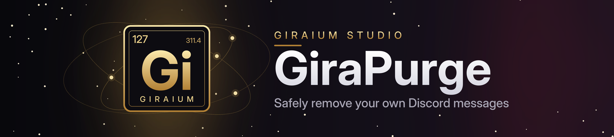

<div align="center">
  

  **A focused Discord plugin for safely removing your own messages.**

  [](https://github.com/Giraium/GiraPurge/releases/latest)
  [](https://github.com/Giraium/GiraPurge/actions/workflows/pages.yml)
  [](https://giraium.github.io/GiraPurge/)

  [Install](https://giraium.github.io/GiraPurge/) · [Changelog](CHANGELOG.md) · [Report an issue](https://github.com/Giraium/GiraPurge/issues)
</div>

> Deleting messages is better than deleting friendships; this plugin lets you safely and precisely delete your own messages from either a DM or a channel.

GiraPurge is an official **Giraium Studio** project for Revenge. It gives you a deliberate workflow: select one DM or channel, review the matching messages, then remove only the messages owned by the current account.

## Install

Add the official repository in Revenge and install **GiraPurge 1.0.0**:

```text
https://giraium.github.io/GiraPurge/
```

If the + button asks for a direct plugin URL instead, use `https://giraium.github.io/GiraPurge/index.js`. Only use the official Giraium Studio repository; unofficial mirrors, modified builds and rebranded packages are not supported.

## Features

- Safe **preview** (dry run) that never deletes anything
- Target selection for DMs and channels
- Date and content rules, include / exclude keywords, configurable session limits
- Deep-history exploration with checkpoints, pause and resume, paced execution
- Live progress, failed / skipped counters, session history, reports and copyable audit details
- **Arabic RTL** and **English LTR** interface

## Safety boundaries

GiraPurge verifies message ownership before every deletion and does not intentionally delete messages that belong to other accounts. It does not request, store or process an account token, and it uses the host application's actions instead of an external REST client. Discord and the host app can change internal behavior, so older history may produce skipped or failed results; review the report after every session.

## Repository layout

```text
src/index.ts     readable TypeScript source of the plugin
site/            everything published to GitHub Pages (installer page, bundle, package, repo listings)
scripts/         release tooling
.github/         issue / PR templates and the Pages deployment workflow
```

## Releasing a new version

1. Bump `version` in `package.json` and `PLUGIN_VERSION` in the bundle (`site/index.js`).
2. Run `python3 scripts/release.py`. It checks both versions match, syncs `site/builds/`, writes `GiraPurge-<version>.zip`, and refreshes the hash, `index.json` and `repo.json`.
3. Commit and push to `main`. The Pages workflow deploys `site/`.

## Support

Ideas and bug reports are welcome through the [issue tracker](https://github.com/Giraium/GiraPurge/issues). For security problems follow [SECURITY.md](SECURITY.md). Remove private message content, account identifiers and tokens from any screenshot or log you share.

## License

GiraPurge is proprietary software owned by **Giraium Studio**. See [LICENSE.md](LICENSE.md), [CONTRIBUTING.md](CONTRIBUTING.md) and [CODE_OF_CONDUCT.md](CODE_OF_CONDUCT.md).

---

<div dir="rtl">

## نبذة بالعربي

**GiraPurge** إضافة لـ Revenge من **Giraium Studio** تحذف رسائلك أنت فقط من محادثة خاصة أو قناة تختارها. فيها معاينة آمنة لا تحذف شيئاً، وقواعد بالتاريخ والكلمات، وإيقاف واستئناف، وتقارير بعد كل جلسة، وواجهة عربية وإنجليزية.

للتثبيت أضف الرابط التالي في Revenge:

`https://giraium.github.io/GiraPurge/`

</div>

---

© 2026 **Giraium Studio**. All rights reserved.
